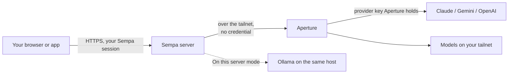

# Using Tailscale Aperture for AI

Sempa's AI features (quick-add parsing, planning, summaries, email-title cleanup
and the rest) normally run on an Ollama model on your own server. If you run
[Tailscale Aperture](https://tailscale.com/docs/aperture), Sempa can use any
model Aperture serves instead: Claude, Gemini, OpenAI, or a model hosted
elsewhere on your tailnet.

## In short

- **No keys in Sempa.** Aperture sits on your tailnet and recognises the Sempa
  server by its host's tailnet identity (so the host needs Tailscale; see
  [the request path](#the-request-path)). Sempa sends requests with no credential at all;
  whatever Aperture's grants allow that identity is what Sempa can use.
- **It asks Aperture what's available.** Sempa reads `GET /v1/models` and lists
  every model Aperture offers this server. For each one it uses the API format
  Aperture says it supports: OpenAI-style `/v1/chat/completions` or
  Anthropic-style `/v1/messages`.
- **One model for everything.** The model you pick runs every AI feature,
  including email-title cleanup on each imported email. Your local Ollama
  settings are kept, so you can switch back any time.

## Set it up

1. Make sure the machine that runs Sempa is on your tailnet with Tailscale
   installed (the bundled sidecar alone isn't enough; see
   [the request path](#the-request-path)).
2. In Sempa, open **Settings → Integrations → AI** and turn on **AI assist**.
3. Under **Where the model runs**, choose **Aperture**.
4. Enter your gateway's URL, for example `https://ai.your-tailnet.ts.net`, and
   press **Connect**. Sempa saves it and lists the models you can use.
5. Pick a model. It's saved straight away.
6. Press **Try it**. Sempa sends one short prompt and shows the answer and how
   long it took. If that works, every AI feature will.

You can also seed the URL with `APERTURE_BASE_URL` in `.env.local`. You still pick
the model in Settings.

## Models listed under "need setting up in Aperture"

These are models Aperture knows about but Sempa can't use as things stand:

- **Passthrough models** (`requires_client_auth`). Aperture forwards these to
  your own provider account, so every request has to carry that account's API
  key. Sempa deliberately holds no keys. To use the model, add your provider key
  to Aperture as a regular (non-passthrough) provider; it then shows up as usable.
  When Aperture lists the same model under both kinds of provider, Sempa shows
  each copy separately (as `provider/model`) so you can pick the one Aperture
  holds the key for.
- **Models offered only on an API Sempa doesn't use**, such as the OpenAI
  Responses API or embeddings.

Sempa never offers a "sign in with Claude" (or similar) option. Anthropic's terms
don't allow third-party apps to route requests through Claude.ai subscription
logins, so keys belong in Aperture.

## Under the hood

For contributors, and for anyone who wants to know exactly what Sempa sends.
The code is `backend/internal/ai/gateway.go`; the settings handlers are in
`backend/internal/api/integrations.go` (`aiTitle*`).

### The request path

The browser never talks to Aperture. Every model call is made by the Sempa
server, over the host's own network connection. Two things follow:

- **The host itself must be on your tailnet.** The bundled `ts-sempa` sidecar
  runs Tailscale in its default userspace mode. That's what publishes your
  `https://sempa.<tailnet>.ts.net` address to your other devices, but it doesn't
  carry the server's own outgoing connections. So for Aperture, install and log
  in to Tailscale on the host as well (skip this if it's already there).
- **The identity Aperture sees is the host's.** That's you, if the host is a
  machine you own, or its tag if it's tagged. Aperture's grants are checked
  against that identity, and it is the only "auth" involved. Sempa sends no
  `Authorization` or `x-api-key` header, ever.

### Finding the models

`GET {gateway}/v1/models` returns an OpenAI-style list. Sempa reads these
fields per model, tolerating any that are missing so a plain OpenAI-compatible
gateway still works:

| Field | What Sempa does with it |
|---|---|
| `id` | The model name to request. |
| `supported_endpoints` | Picks the API to call (below). Empty means "assume chat". |
| `metadata.provider.id` | Shown under the model name, and used to tell duplicates apart. |
| `metadata.provider.requires_client_auth` | `true` means passthrough: listed as unusable, because Sempa holds no key. |
| `context_window_tokens` | Shown beside the model (e.g. `200k`). |

When the same `id` appears under two providers (Aperture often lists a Claude
model as both a passthrough copy and a copy it holds the key for), each copy is
named `provider/id`, which is also how Aperture is asked for a specific copy.
Asking by the bare id could land on the passthrough copy and fail.

Lists are cached for 60 seconds, and a failed lookup for 20, so an unreachable
gateway never makes every settings load wait out a timeout. Pressing
**Connect** always fetches fresh.

### Choosing the API

| Model offers | Sempa calls |
|---|---|
| anything with `chat` (e.g. `openai_chat`) | `POST /v1/chat/completions` (preferred: it has a JSON mode) |
| only `messages` (`anthropic_messages`) | `POST /v1/messages` with `anthropic-version: 2023-06-01` |
| only something else (`openai_responses`, embeddings) | nothing: listed as unusable |

If a chosen model has dropped out of the cached list, Sempa refreshes once
before calling. If it still can't find it, it tries chat and passes Aperture's
error on, since those errors say precisely which API the model wants.

### Making a call

- Features that need structured answers (quick add, plan my day, tags…) send a
  short system instruction asking for JSON only, plus `response_format:
  json_object` on chat. Replies are still parsed leniently, so a model that adds
  prose around the JSON doesn't break anything.
- `max_tokens` is at least 1024 for gateway models. The local defaults are sized
  for a 1.5B CPU model; some cloud models spend part of their budget reasoning
  first and would be cut off mid-answer.
- If a provider refuses the request as malformed (HTTP 400), Sempa retries once
  with only `model` and `messages` (plus `max_tokens` on the Anthropic API).
  Some reasoning models reject a temperature, and not every provider has JSON
  mode.
- A 429, 502, 503 or 504 is retried once after about a second.
- Gateway calls time out after 90 seconds; email-title cleanup gives up after 20
  and keeps the original subject.

### Reaching the gateway from a container

If the system resolver can't find a `*.ts.net` name (common inside containers
whose DNS isn't MagicDNS, even when the host is on the tailnet), Sempa asks
Tailscale's own resolver at `100.100.100.100` directly and connects to the
address it returns. TLS is still verified against the URL's host name. This only
helps when the host runs Tailscale: the sidecar's userspace mode doesn't answer
on that address for the server.

### Where the settings live

The AI settings are one JSON record (integration key `ai_title`): the Ollama URL
and model, plus `provider`, `gateway_url` and `gateway_model`. Both sets are
kept, so switching modes loses nothing. `APERTURE_BASE_URL` only seeds the
gateway URL until you save settings. An app from before 1.30 that toggles AI
can't reset a gateway choice, because the server only changes the provider
fields when they're sent.

### Security

- Sempa holds **no provider credentials**. Passthrough models are routed to
  Aperture, which is where keys belong.
- The server only ever fetches a gateway URL that has been **saved** by the
  signed-in owner, and checks it's a well-formed http(s) URL. **Connect** saves
  the URL before listing; **Try it** uses only saved settings. No request can
  point the server at an arbitrary address.
- Like the Ollama URL, the gateway URL is allowed to be a private or tailnet
  address, because that's where it lives. This is the accepted request-forgery
  finding documented in `fastmail/aititle.go` and `SECURITY.md`.

## Troubleshooting

**"Aperture not reachable from this server"**: the Sempa server makes the
requests, not your browser. It has to reach the gateway over the tailnet.

- Make sure Tailscale is running **on the host itself**, not only in the
  `ts-sempa` sidecar: `tailscale status` on the host should list your gateway.
- Then check the host can open the URL:
  `curl -sS https://ai.your-tailnet.ts.net/v1/models`.
- If the error says the name can't be resolved, Sempa has already retried
  through Tailscale's own DNS (`100.100.100.100`). If that also failed, the host
  isn't connected to the tailnet.

**Connected, but no usable models**: Aperture's grants decide what each tailnet
identity may use. Grant the identity Aperture sees for the Sempa host: its owner,
or its tag if it's tagged. An error from Aperture names the identity it saw.

**A model is listed but "Try it" fails**: Sempa shows Aperture's own error,
which usually says what's wrong (for example, which API the model expects, or a
missing provider key).

## Costs and privacy

With Aperture, prompts leave your server and go to whichever provider serves the
model. Cloud models may charge per request. Email-title cleanup runs once for
each imported email, so pick a small, fast model if you import a lot of mail. The
local Ollama option remains the default, and with it nothing leaves your server.
